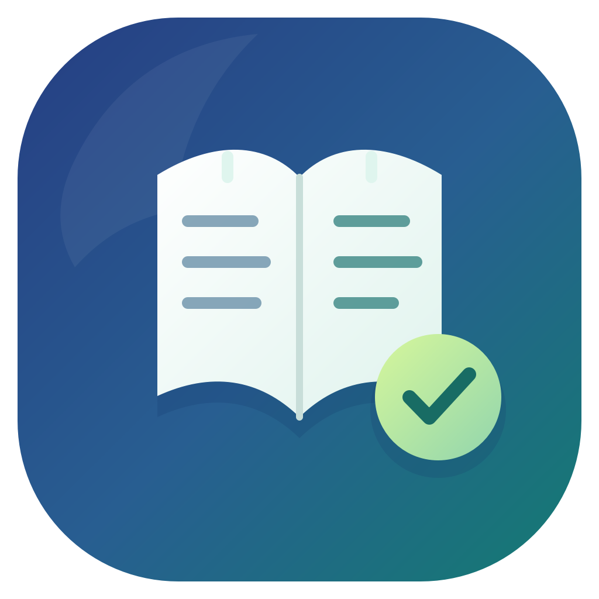
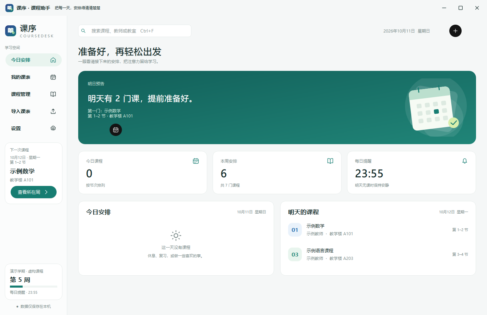
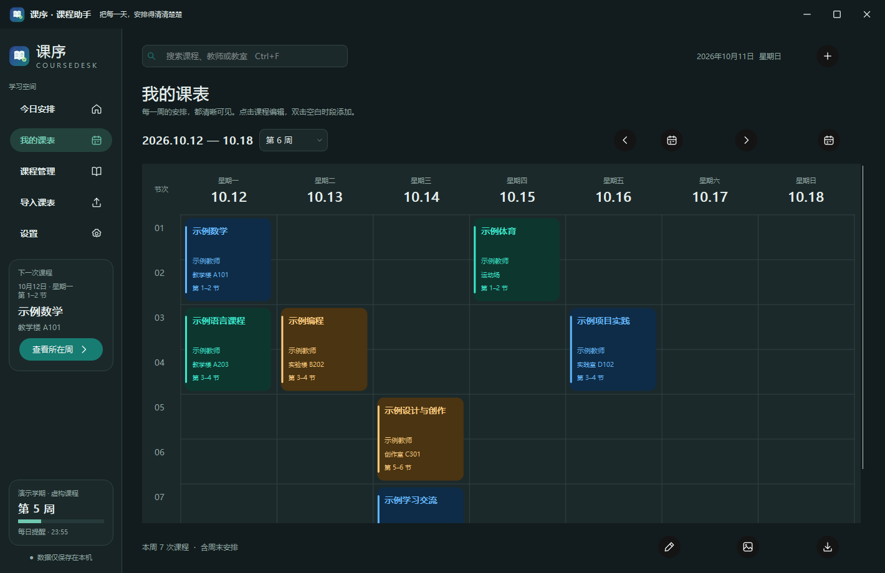

<div align="center">
  
  <h1>课序 · CourseDesk</h1>
  <p>把每一天，安排得清清楚楚。</p>
  <p>本地课表管理与明日课程提醒 · Windows 中文桌面应用</p>
  <p>
    <a href="https://github.com/g1Ix/CourseDesk/releases"></a>
    
    <a href="LICENSE"></a>
  </p>
  <p><strong>创作者：g1Ix · 版权所有 © 2026 g1Ix</strong></p>
</div>

## 下载与开始使用

1. 在 [Releases](https://github.com/g1Ix/CourseDesk/releases/latest) 下载 `CourseDesk-1.0.0-Windows-x64.zip`。
2. **完整解压**，双击 `CourseAssistant.exe`。便携版自带运行环境，不需要安装 Python。
3. 在“设置”填写学期起止日期与周次，在“导入课表”导入自己的文件，或手动添加课程。
4. 如需每日提醒，在应用文件夹打开 PowerShell，运行 `powershell -NoProfile -ExecutionPolicy Bypass -File .\install_task.ps1`。脚本创建当前用户的桌面、开始菜单快捷方式和每日提醒任务。

首次使用是**空课表**。示例、截图和测试均使用虚构内容，发布包不包含创作者的个人课表。

## 界面预览

以下截图使用独立的演示数据，不代表真实的课程安排。




## 功能

- **今日与明日安排**：查看课程、教师、教室及节次；首页问候语轮换。
- **按周浏览**：跳转日期，展示周末，点击课程编辑，双击空白时段添加。
- **规律与临时课程**：按星期和周次重复，支持单次增课、停课及当天覆盖。
- **课程编辑**：选择仅改一次、从指定日期起修改，或修改整条重复安排。
- **本地导入**：图片、多页 PDF 使用 Windows OCR；JSON / CSV 也支持导入。识别结果先校对，再保存。
- **每日提醒**：默认 23:55 通过 Windows 通知显示明天的课程，无课时静默。
- **外观与窗口**：浅色、深色、跟随系统；可缩放的无边框窗口；图标在文字右侧的按钮过渡。
- **备份与导出**：保存前自动备份，支持恢复、JSON / CSV 导出以及课表图片导出。

## 数据与隐私

课表、设置和备份位于 `%LOCALAPPDATA%\CourseDesk`，不写进程序文件夹。OCR 在本机运行；应用不上传课表，也不集成分析或遥测服务。数据以未加密 JSON 保存，请保护自己的 Windows 用户账户与备份。

默认过滤周日课程名含“实验／實驗”的课程；可在设置中关闭。导入原始数据不会因过滤而永久丢失。没有现成课表？可手动录入，或导入 [CSV 示例](examples/template.csv) / [JSON 演示课表](examples/demo-schedule.json)，随后调整学期日期。

## 运行条件与限制

- 目标平台为 Windows 10 / 11 x64；1.0 的实际桌面验收在 Windows 11 上完成。
- 图片与 PDF 的识别需要 Windows OCR 及相应语言包。中文 OCR 不可用时仍可手动录入或导入 CSV / JSON。
- OCR 主要针对带星期列和节次行的网格课表；不同学校版式、模糊截图可能需要较多校对，不保证全自动准确。
- 提醒需要用户已登录桌面。关机、休眠或系统关闭通知时无法即时显示；错过计划时间后会补运行，并查询运行时的“明天”。
- 便携包未做代码签名，Windows 可能显示来源提示。请核对下载地址与 Release 提供的 SHA256。

## 从源码运行

推荐 Windows 上使用 Python 3.12–3.14。

```powershell
git clone https://github.com/g1Ix/CourseDesk.git
cd CourseDesk
py -m venv .venv
.\.venv\Scripts\python.exe -m pip install -r requirements-dev.txt
.\.venv\Scripts\python.exe course_assistant.py
```

测试及打包：

```powershell
.\.venv\Scripts\python.exe -m unittest discover -s tests -v
powershell -NoProfile -ExecutionPolicy Bypass -File .\build_desktop.ps1
```

构建输出到 `desktop/`、`portable/` 和 `release/`；不会打包用户目录或课表文件。修改 PySide6 / Qt 应用依赖后，应重新检查第三方许可和 Windows 实机兼容性。

## 文档与参与

- [使用说明](USER_GUIDE.md) · [隐私说明](docs/PRIVACY.md) · [更新记录](CHANGELOG.md)
- [贡献指南](CONTRIBUTING.md) · [行为准则](CODE_OF_CONDUCT.md) · [安全问题](SECURITY.md)
- [提交问题](https://github.com/g1Ix/CourseDesk/issues) · [项目支持](SUPPORT.md)

## 许可证与致谢

应用原创源码由 **g1Ix** 持有版权，以 [MIT](LICENSE) 许可发布。开放使用许可不转移版权归属。

PySide6、Qt、Python 等组件遵循各自许可证，不适用本项目 MIT 许可。便携版包含对应运行库、声明与许可证，见 [第三方声明](THIRD_PARTY_NOTICES.txt)。按钮交互参考 [vinodjangid07 的 smart-emu-83](https://uiverse.io/vinodjangid07/smart-emu-83)，其 MIT 声明保留于 `licenses/`。
